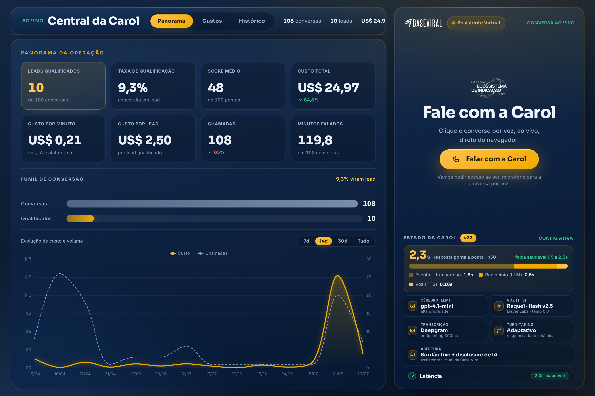
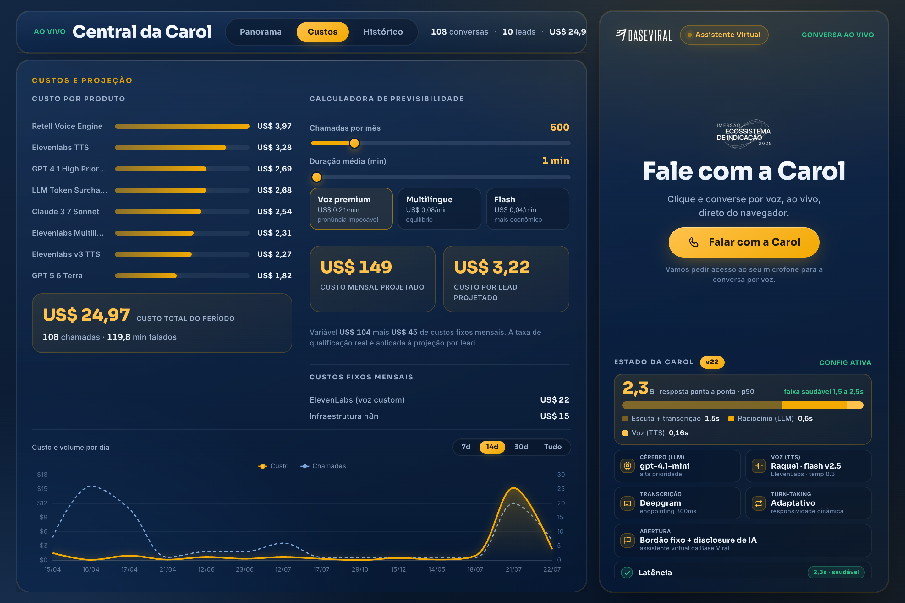
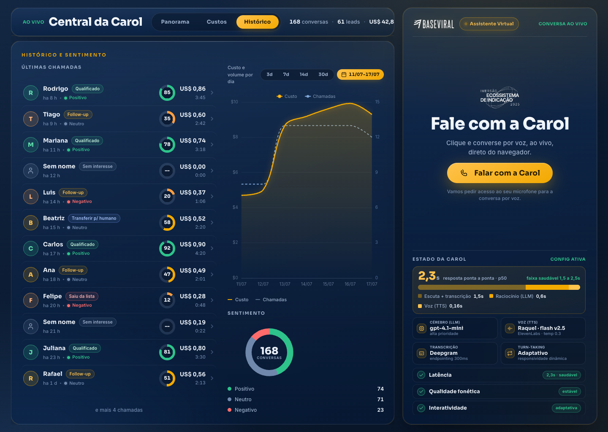
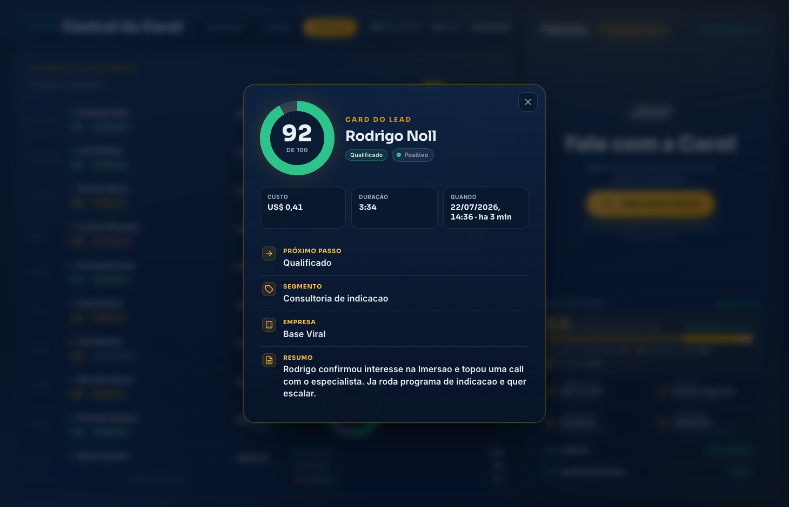
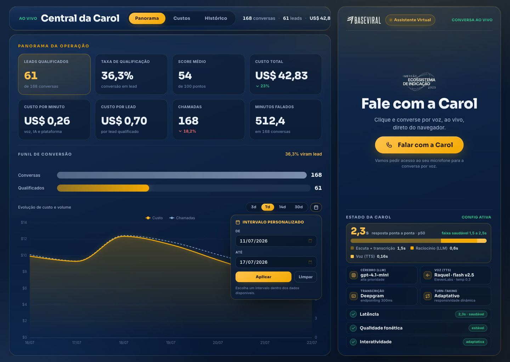
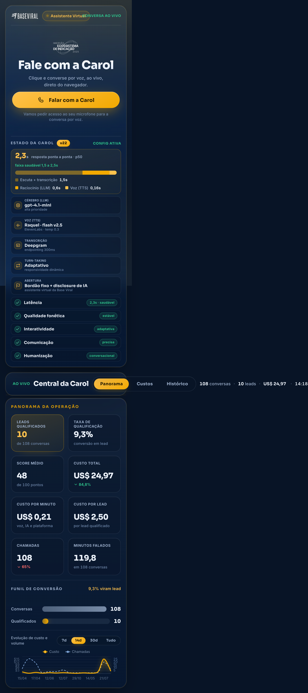

<div align="center">

# Linha Viva · SDR de Voz com IA

### A agente que liga, conversa como gente, qualifica e agenda. Sem fila, sem rampa, sem no-show na pré-venda.

Pré-venda por ligação de voz com IA. A **Carol** disca em minutos, sustenta uma conversa natural em português, entende quem é o lead, qualifica pelo score e marca a reunião no calendário do closer. Cliente-piloto: **Base Viral** (Rodrigo Noll, Imersão Ecossistema de Indicação).

<br/>


<br/>



<sub>Central da Carol. A esquerda, o painel de operacao ao vivo. A direita, o web call de demonstracao da Base Viral com o estado tecnico da agente em tempo real.</sub>

</div>

<br/>

---

## O que e

**Linha Viva** e um SDR de pre-vendas que faz ligacoes ativas de voz com IA. A agente **Carol** liga para leads que se aplicaram a uma imersao, se apresenta como assistente virtual, conduz uma conversa fluida em portugues, captura as variaveis que importam (nome, empresa, segmento, modelo de indicacao que a pessoa ja roda hoje), pontua o lead e agenda a reuniao com o especialista humano. O que sai da chamada e um card qualificado com resumo, score, gravacao e proximo passo, entregue direto ao closer.

O nome de produto **Linha Viva** e a marca do servico gerenciado (replicavel a outros clientes). A **Carol** e a instancia configurada para a Base Viral. Vende-se como servico: setup de implantacao mais mensalidade de operacao. Este repositorio e o registro tecnico do que foi construido: a stack de voz, o tuning real da agente, os workflows de automacao, o parecer de compliance e o painel de operacao.

> [!IMPORTANT]
> **Regras duras do produto (NON-NEGOTIABLE).** A Carol se identifica como assistente virtual na abertura e **nunca** nega ser IA. A humanizacao mora na fluidez da voz, jamais no engano. Aviso de gravacao, opt-out honrado em tempo real, janela de discagem Anatel e preco vindo so da fonte de verdade sao travas embarcadas, nao preferencias de tom. Detalhes na secao [Compliance by design](#compliance-by-design).

---

## Arquitetura

Um lead entra, o n8n aplica os portoes de compliance antes de discar, a Retell orquestra a voz (transcricao, cerebro e fala), a chamada acontece, os eventos voltam por webhook, o n8n roteia o resultado para CRM, agenda e closer, e tudo aparece no painel.

```mermaid
%%{init: {'theme':'base','themeVariables':{'primaryColor':'#0B1B33','primaryTextColor':'#EAF0F8','primaryBorderColor':'#F2A900','lineColor':'#ffc24d','clusterBkg':'#081426','clusterBorderColor':'#1c3a5e','fontFamily':'Inter, sans-serif'}}}%%
flowchart LR
  Lead([Lead opt-in]):::src --> Norm
  subgraph DISPARO[n8n · disparo e gates]
    direction TB
    Norm[Normalizar E164]:::n8n --> Gate{Gate de compliance<br/>opt-out · janela Anatel · lock Redis}:::gate
  end
  Gate -->|aprovado| STT
  subgraph RETELL[Retell AI · orquestracao de voz]
    direction TB
    STT[Deepgram STT<br/>endpointing 300ms]:::voice --> LLM[LLM gpt-4.1-mini<br/>alta prioridade]:::voice --> TTS[ElevenLabs Flash v2.5<br/>voz Raquel]:::voice
  end
  TTS --> Call((Ligacao ao vivo<br/>Carol e Lead)):::call
  Call -->|webhook eventos| WH
  subgraph POS[n8n · pos-chamada]
    direction TB
    WH[Webhook<br/>HMAC + idempotencia]:::n8n --> Extract[Extracao<br/>call_analyzed]:::n8n --> Route{proximo_passo}:::gate
    Route --> CRM[CRM + Agenda<br/>+ Notifica closer]:::n8n
  end
  CRM --> Painel[Painel Central da Carol<br/>Vercel]:::ui

  classDef src fill:#081426,stroke:#2ec38b,stroke-width:2px,color:#EAF0F8
  classDef n8n fill:#0B1B33,stroke:#F2A900,color:#EAF0F8
  classDef voice fill:#0B1B33,stroke:#ffc24d,color:#EAF0F8
  classDef gate fill:#12233F,stroke:#ff6b6b,color:#EAF0F8
  classDef call fill:#F2A900,stroke:#F2A900,color:#081426
  classDef ui fill:#081426,stroke:#2ec38b,color:#EAF0F8
```

### Stack

| Camada | Tecnologia | Papel no fluxo |
|---|---|---|
| Orquestracao de chamada | **Retell AI** | Turn-taking, streaming, gestao de STT, LLM e TTS, webhooks e extracao pos-chamada. |
| Transcricao (STT) | **Deepgram** (`endpointing 300ms`) | Escuta precisa e rapida. Substituiu o modo `accurate`, que era preciso porem lento. |
| Cerebro (LLM) | **OpenAI gpt-4.1-mini** (alta prioridade) | Decide o proximo passo com latencia consistente, sem os picos do modelo full. |
| Voz (TTS) | **ElevenLabs Flash v2.5** (voz Raquel, `temp 0.3`) | Fala PT-BR natural e estavel, com inferencia de 160ms. |
| Automacao de negocio | **n8n** (`n8n.bilinski.cloud`) | Disparo, gates de compliance, idempotencia (Redis `SET NX EX`), roteamento, CRM, agenda e retry. |
| Painel de operacao | **Vercel** | Central da Carol: KPIs ao vivo, custos, historico e estado do agente. |

---

## Latencia (engenharia real)

Em voz, latencia e o produto. Uma ligacao que trava ou responde tarde denuncia a IA e mata a conversa. A medicao real dos eventos da Retell mostrou uma verdade contra-intuitiva: **o gargalo nunca foi o cerebro**. O LLM responde em cerca de 0,6s. O maior pedaco do tempo e a escuta educada, o momento em que a agente espera o lead terminar de falar antes de responder.

A decisao de engenharia foi consciente: **nao espremer a latencia abaixo do saudavel**. Reduzir o endpointing abaixo de 300ms faria a Carol atropelar a fala do interlocutor, o que soa pior do que 300ms de pausa. O piso saudavel da latencia e a educacao de ouvir.

| Etapa | Tempo | O que acontece |
|---|:---:|---|
| Escuta + transcricao (Deepgram) | **1,50s** | Ouvir o lead ate ele terminar de falar. A "escuta educada". |
| Raciocinio (LLM gpt-4.1-mini) | **0,60s** | Decidir o proximo passo da conversa. |
| Voz (TTS ElevenLabs Flash v2.5) | **0,16s** | Sintetizar a fala de resposta. |
| **Total ponta a ponta (p50)** | **2,30s** | Faixa saudavel definida: 1,5s a 2,5s. |

```text
Escuta + transcricao   ████████████████████████████████  1,50s
Raciocinio (LLM)       █████████████                      0,60s
Voz (TTS)              ███                                0,16s
e2e p50                                                   2,30s  (faixa saudavel 1,5 a 2,5s)
```

A trajetoria de tuning derrubou o e2e de 2,8s para 2,3s p50 trocando o modo de transcricao para Deepgram custom, sem abrir mao da estabilidade da voz. Ganho medido, nao estimado.

---

## Compliance by design

Ligacao ativa de voz com IA e o cenario de maior risco juridico do mercado de IA conversacional, porque a voz sintetica soa humana e o interlocutor nao tem o tempo de leitura que o alertaria. Por isso o compliance nao e um adendo, e uma trava embarcada no nucleo do fluxo (n8n mais prompt), nao relaxavel por configuracao do cliente. O parecer completo, com os 8 vereditos em farol e as fontes normativas, vive em [`legal/PARECER-LEGAL.md`](legal/PARECER-LEGAL.md).

| Invariante | Como esta embarcado |
|---|---|
| **Disclosure de IA** | A Carol abre se identificando como assistente virtual da Base Viral. Bordao fixo, garantido em toda call. Nunca nega ser IA se perguntada. Trava inegociavel. |
| **Aviso de gravacao** | Declarado na abertura, junto do disclosure e do motivo do contato, antes de coletar qualquer resposta relevante. |
| **Opt-out em tempo real** | A agente reconhece "nao me ligue mais" na linguagem natural, confirma, encerra e dispara supressao **global**, valida para todas as sequencias, nao so a campanha atual. |
| **Janela de discagem Anatel** | Gate pre-chamada no n8n: segunda a sexta 9h as 20h, sabado 10h as 13h, nunca domingo e feriado, ajustado ao fuso do DDD. Scrub contra a lista Nao Me Perturbe. |
| **Base legal documentada** | So disca lead com opt-in comprovado (aplicou-se a imersao), com prova de origem e teste de balanceamento (LIA) registrado. |
| **Preco so da fonte de verdade** | Tudo que a Carol afirma vincula o fornecedor (CDC art. 30). Ela so repete valor, prazo e vaga cadastrados. Zero improviso de numero, zero promessa de resultado, escassez so se real. |
| **Dados e retencao** | PII mascarada na transcricao, retencao com expurgo, DPA com os suboperadores (Retell, ElevenLabs, hospedagem do n8n) e transferencia internacional endereçada. |

Essa maturidade de compliance e um diferencial comercial: o produto entra no ar defensavel, nao improvisado.

---

## Engineering log (v5 → v22)

A Carol nao nasceu redonda. Ela foi lapidada em 22 iteracoes versionadas, cada uma com backup bruto datado (restauravel por `PATCH` na API) e validacao por medicao real. A bussola de toda decisao foi uma diretriz do operador: **qualidade de conversa natural acima de velocidade**. Deixar a agente mais rapida, em varios momentos, piorava a experiencia.

A historia e um passeio por trade-offs reais de produto de voz:

- **Latencia x inteligencia.** A medicao provou que o gargalo era a escuta e a transcricao, nao o LLM. Trocar o cerebro por um modelo mais esperto quase nao custou latencia. Trocar o modo de transcricao custou o tempo todo.
- **Estabilidade x pronuncia.** A raiz da anglicizacao de nomes ("Luiz" lido como "LOOU-IZI") era a voz, nao o texto. O modelo `eleven_v3` habilitava o dicionario fonetico IPA, mas era instavel em tempo real ("varias vozes numa frase"). A escolha final, `flash_v2.5`, priorizou a consistencia call a call.
- **Consistencia x elaboracao.** O `gpt-4.1` full dava respostas mais elaboradas, mas com picos de latencia que viravam travadas. O `gpt-4.1-mini` entrega um papo levemente menos rebuscado com fluidez estavel. A demo escolheu estabilidade.
- **Preview engana, a call real decide.** Uma voz nativa brasileira "no papel" (Cartesia Hailey) foi aprovada no preview curto e reprovada na ligacao real. Licao registrada: nunca trocar voz sem o operador validar numa call de verdade.

| Marco | O que mudou |
|:---:|---|
| **v5** | Baseline documentado, com snapshots brutos da API salvos. |
| **v6** | Qualidade e clareza: ambiente sonoro suavizado, boosted keywords do negocio, captura das variaveis do lead, extracao pos-chamada de 2 para 14 campos. |
| **v7** | Correcoes pos-teste real: horario em PT-BR, confirmacao de nome obrigatoria, fechamento enriquecido, fila dedicada (`high_priority`). |
| **v8** | Humanizacao: voz estavel (`temperature` reduzida), cerebro mais fluido, prompt endurecido para 1 frase por turno rumo ao agendamento. |
| **v9 a v10** | Polimento: pronuncia 100% BR, fuso raciocinado em silencio, agendamento com 2 opcoes concretas em horario comercial. |
| **v11 a v14** | Caca a raiz da fonetica: voz como determinante do sotaque, reversao consciente, backchannel curado. |
| **v15** | Raiz da pronuncia resolvida. Voz para `eleven_v3` habilita o IPA. Aprovado pelo operador. |
| **v16 a v17** | Coleta obrigatoria das 4 variaveis do score. Primeira rodada de latencia, com custo por minuto 32% menor. |
| **v19 a v20** | Latencia x inteligencia por medicao real. Disclosure garantido no bordao fixo. |
| **v22** | **Config oficial da demo.** `gpt-4.1-mini` + `flash_v2.5` + Deepgram `endpointing 300ms`. e2e de 2,8s para 2,3s p50. Decisao consciente de nao espremer mais. |

O changelog completo, iteracao por iteracao, com diagnostico e backup de cada passo, esta em [`docs/engineering-log.md`](docs/engineering-log.md).

---

## Como funciona (galeria)

<table>
  <tr>
    <td width="50%" valign="top">
      
      <br/><sub><b>Custos e projecao.</b> Custo real por produto (Retell, ElevenLabs, LLM), calculadora de previsibilidade por volume e duracao, e custos fixos mensais. A operacao de referencia projeta cerca de US$ 149/mes com margem saudavel.</sub>
    </td>
    <td width="50%" valign="top">
      
      <br/><sub><b>Historico e sentimento.</b> Cada chamada com score, tag de resultado, sentimento, custo e duracao. O donut consolida o sentimento das 168 conversas em positivo, neutro e negativo.</sub>
    </td>
  </tr>
  <tr>
    <td width="50%" valign="top">
      
      <br/><sub><b>Card do lead.</b> O que sai de cada chamada: score, custo, duracao, proximo passo, segmento, empresa e o resumo que a IA extraiu da conversa. Pronto para o closer.</sub>
    </td>
    <td width="50%" valign="top">
      
      <br/><sub><b>Seletor de periodo.</b> Presets de 3, 7, 14 e 30 dias mais intervalo personalizado, aplicados ao grafico de evolucao de custo e volume.</sub>
    </td>
  </tr>
  <tr>
    <td colspan="2" align="center" valign="top">
      
      <br/><sub><b>Mobile.</b> Layout responsivo empilhado: o web call e o estado da agente no topo, o painel de operacao logo abaixo. O estado da Carol confirma latencia, qualidade fonetica, interatividade, comunicacao e humanizacao em selos verdes.</sub>
    </td>
  </tr>
</table>

---

## Como rodar

A demo de fechamento e um web call self-contained: a pessoa abre a pagina, clica e conversa com a Carol pela voz, direto do navegador. A infraestrutura de nuvem (agente Retell e workflows n8n) fica ativa, so o servidor local da pagina precisa subir.

```bash
cd demo
python3 -m http.server 8000
```

Depois abra `http://localhost:8000/web-call.html` e clique em **Falar com a Carol**. Alternativa sem servidor: o dashboard da Retell, aba Simulacao, botao do microfone.

O guia operacional completo (endpoints ativos, IDs, telefonia BR real via SIP trunk e ajustes da agente) esta em [`docs/operacao.md`](docs/operacao.md).

> [!NOTE]
> **Segredos nunca no chat, nunca versionados.** As chaves de API (Retell, ElevenLabs, n8n) sao injetadas por ambiente. Consulte [`SECURITY.md`](SECURITY.md) e [`.env.example`](.env.example) para os nomes das variaveis e o fluxo de configuracao.

---

## Estrutura do repo

```text
.
├── docs/
│   ├── screenshots/         # capturas do painel Central da Carol
│   ├── engineering-log.md   # changelog completo v5 → v22 (tuning por medicao real)
│   └── operacao.md          # runbook: rodar a demo, endpoints, telefonia BR
├── demo/                    # web call self-contained + player pre-gravado
├── n8n/                     # os 5 workflows (spec node a node + JSONs exportaveis)
├── agente/                  # config da Carol: prompt, retell-config, schema de extracao
├── legal/                   # parecer de compliance (LGPD, CDC, Anatel)
├── SECURITY.md              # gestao de segredos
└── .env.example             # variaveis de ambiente
```

Os 5 workflows n8n seguem um padrao de engenharia de producao: `voz-lib-config` (constantes), `voz-sdr-disparo` (lead para ligacao, com os gates), `voz-sdr-webhook` (eventos Retell com verificacao HMAC), `voz-sdr-pos-chamada` (roteamento por resultado) e `voz-sdr-on-error` (falha nunca silenciosa). Idempotencia via Redis, assinatura de webhook verificada e `call_analyzed` como unico gatilho de automacao. A spec completa esta em [`n8n/SPEC-workflows.md`](n8n/SPEC-workflows.md).

---

<div align="center">
<sub>

**Linha Viva** · SDR de voz com IA · construido com Retell AI, ElevenLabs, Deepgram, OpenAI, n8n e Vercel.

Cliente-piloto: Base Viral (Rodrigo Noll). Registro tecnico privado. 2026.

</sub>
</div>
